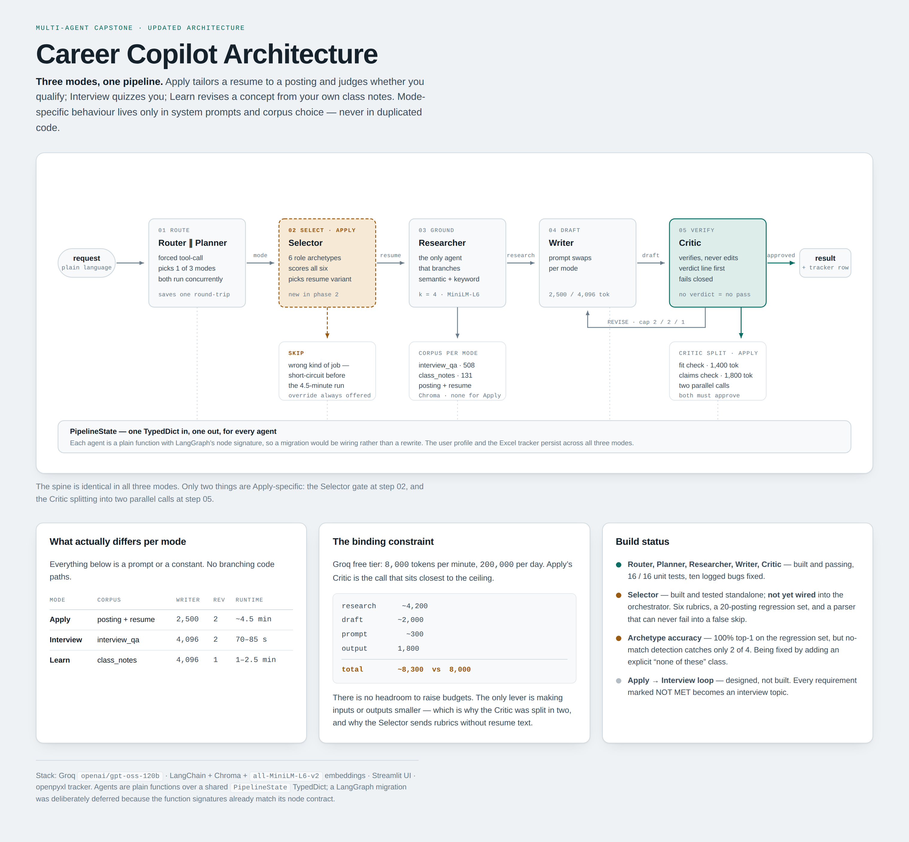

# Career Copilot

A multi-agent LLM system for job search, built to answer one question honestly:
**how do you stop an AI from confidently making things up?**

Three modes — tailor a resume to a posting, run a mock interview, review a
concept from your own notes — share a single agent pipeline. Every claim the
system makes about you has to trace back to a source document, and a separate
Critic agent is responsible for proving it does.



---

## Why this project exists

The interesting problem here isn't getting an LLM to write resume bullets. It's
that **an agent will produce confident, well-organised, completely ungrounded
output, and it looks correct until you check.**

The first live run produced a polished draft claiming a "70% VRAM reduction",
a "3× throughput boost" and "10k RPS". None of those numbers appeared anywhere
in the source resume. The Critic approved it on round one.

Most of the engineering in this repo is the response to that: making
verification structural rather than a matter of trusting the output.

## Architecture

A **hybrid** design — hierarchical routing on top, a sequential chain
underneath.

```
                    ┌──────────────────────────────┐
   user request ──> │  ROUTER  (forced tool-call)  │  picks exactly 1 mode
                    └──────────────┬───────────────┘
              ┌────────────────────┼────────────────────┐
           Apply                Interview              Learn
        no corpus;            interview_qa          class_notes
      posting + resume        (508 Q&A pairs)      (131 chunks)
              └────────────────────┼────────────────────┘
                                   v
        ┌──────────────────────────────────────────────────┐
        │  Planner → Researcher → Writer ⇄ Critic           │
        │                          └── REVISE loop ────┘    │
        │        ONE SHARED CHAIN — debugged once           │
        └──────────────────────────────────────────────────┘
```

The Router classifies intent via a forced tool-call, so it can never fall
through to a plain-text answer. All three modes then run the *same* chain —
mode-specific behaviour lives only in system prompts and corpus choice, never
in duplicated code.

Every agent is a plain function with the signature `state -> state`. That's
deliberately LangGraph's node signature: migrating to a graph framework would
be a wiring change, not a rewrite.

**Why one chain matters:** the Critic grounding fix below was a one-line change.
Because there is only one Critic, it fixed all three modes at once.

## The three bugs that shaped the design

Each of these produced output that looked correct on first read.

### 1. The Writer invented metrics

The Critic's prompt asked it to check *"accuracy, clarity, completeness"* — in
the abstract. Nothing instructed it to verify a single number against a single
source. **Fix:** mode-specific prompts; when the resume has no number for a
claim, the Writer must emit a `[quantify: ...]` placeholder rather than invent
a plausible statistic.

### 2. The Critic was never shown the research

Once the Writer stopped fabricating, the Critic started flagging *real* numbers
as unsourced. Two rounds were spent rewording its prompt before reading its
actual output, which said: *"No external research text was provided."*

It wasn't hallucinating. `state['research']` was never passed into its prompt —
a gap present since the original scaffold, invisible until something finally
asked the Critic to check a specific claim against a specific source.

**This is the one worth noting.** Bugs 1 and 3 were prompt fixes. This was a
one-line *code* fix, and it presented so convincingly as a prompt problem that
two attempts were wasted on prompt wording first.

### 3. The posting's minimum became the candidate's tenure

The draft said "5+ years"; the resume said "11+". The Critic approved it,
because "5+ years" genuinely *was* in the research — in the job posting
section, as the employer's requirement. **Fix:** both agents taught what the
`Job posting:` / `Resume:` labels mean, and that only resume-sourced numbers
are facts about the candidate.

The general shape: `research` held two kinds of content with different
trustworthiness, and no agent distinguished them. That pattern recurred twice
more (see [HANDOFF.md](HANDOFF.md)).

## Evidence it works

| Adversarial case | Behaviour |
|---|---|
| Topic absent from the corpus | States plainly what the research does and doesn't cover; refuses to answer from training knowledge |
| Embedded-systems posting vs. an ML resume | Every core requirement honestly marked NOT MET, direct "weak match" recommendation, no softening |
| TF-IDF explanation with subtle errors | Critic returns REVISE with six specific, actionable notes — not a rubber stamp |

## Apply-mode Selector (Phase 2)

Six resume variants are matched against a posting to decide **which to send**
and whether to apply at all.

The approach was chosen from a measurement, not a guess. `analyze_resume_overlap.py`
found pairwise TF-IDF cosine similarity of **0.95–0.985** across the six — they
are one resume reordered, not six different sets of qualifications. Embedding
similarity would have produced confident scores differing in the third decimal:
noise presented as signal. So selection is done by an LLM reasoning over
hand-written archetype rubrics instead.

Evaluated against `jd_testset/` — 20 labelled postings including deliberate
hybrids, misleading titles, out-of-space roles, and vague recruiter spam.

> The test set's own `labels.json` records that the JDs and the rubrics were
> written by the same assistant, so a good score there measures internal
> consistency, not real-world accuracy. Validation against independently
> labelled real postings is still outstanding. That caveat is in the repo
> because a benchmark that doesn't state its own limits isn't a benchmark.

## Running it

```bash
pip install -r requirements.txt
export GROQ_API_KEY=...          # Windows: setx GROQ_API_KEY "..."

cp resume.sample.txt resume.txt               # or use your own
cp resumes.sample.json resumes.json
cp user_profile.sample.json user_profile.json

streamlit run app.py             # UI
python orchestrator.py jd.txt    # CLI, reads a posting from a file
uvicorn api:app --port 8000      # REST + SSE backend for web/
```

Real resume data is gitignored; the `.sample.*` files are a fictional candidate
so the pipeline runs end to end out of the box.

**Stack:** Python · Groq (`openai/gpt-oss-120b`) · ChromaDB · sentence-transformers ·
Streamlit · FastAPI · Next.js + TypeScript · openpyxl

## Tests

```bash
python test_tracker.py           # 16 tests, offline, no API key
python test_selector_parser.py   # Selector output parsing, offline
python test_archetypes.py        # rubric config validation, offline
python test_grounding.py         # adversarial regression cases (needs API key)
```

`test_grounding.py` is the interesting one: each case is a fixture engineered to
tempt one of the three bugs above — a resume with no numbers, a posting whose
stated minimum conflicts with the real tenure — with assertions on the resulting
draft and critique. They exist so a future prompt tweak can't silently
reintroduce a bug that's already been fixed.

## Engineering notes

- **Concurrency.** Router and Planner don't depend on each other, so they run in
  a shared thread pool — one network round-trip saved per request.
- **Token budgets, measured not guessed.** The free tier allows 8,000 tokens per
  request. Apply-mode input alone is ~6,500, so the Critic's two parallel checks
  are capped at 1,400 and 1,800 — both raised after observing real truncation.
- **Rate limits.** Groq's errors carry a suggested wait time in the message text;
  it's parsed and honoured, with a fast failure when the wait implies the daily
  quota rather than the per-minute one.
- **Vendor evaluation.** Switching to `llama-3.3-70b-versatile` was investigated
  and rejected: more tokens per minute but half the daily quota, and
  `reasoning_effort` — the fix for one real failure mode — is specific to the
  current model. Every budget here was measured against its behaviour.

## Known limitations

Kept deliberately, because a project that claims no open problems is usually
one that hasn't been looked at hard enough.

- **The Researcher's own search query is stored inside `research`**, so a model-authored
  query can be read back as if it were retrieved source material. Observed and
  logged; same family as bug 3. Not yet fixed.
- **Single-user, local-file state.** `user_profile.json` and an Excel tracker. No
  auth, no database, no multi-tenancy.
- **Apply mode takes ~4.5 minutes** — several sequential LLM calls with up to two
  revision rounds.
- **The Selector test set is self-consistent, not externally validated** (above).
- **No temperature is set anywhere.** Defaults throughout; for the Critic there's
  a real argument for `temperature=0` that hasn't been acted on because every
  token budget was tuned against current behaviour.

Full history in [PROGRESS.md](PROGRESS.md); open items and deferred decisions in
[HANDOFF.md](HANDOFF.md).
